# ACTIVITY 3 - EXPLORING WINDOWS COMMAND LINE (TERMINAL / POWERSHELL)

## Page 1

Republic of the Philippines 
<strong>Sorsogon State University</strong> 
<strong>COLLEGE OF INFORMATION</strong> 
<strong>AND COMMUNICATIONS TECHNOLOGY</strong> 
<strong>Bulan Campus</strong> 
<em>Zone 8, Bulan, Sorsogon</em> 
Tel. No.; 056 311-0103; Email Address:cict@sorsu.edu.ph

<strong>CC 101 Laboratory Activity: Exploring the Windows Command Line</strong>

<table>
  <tr>
    <td><strong>Name:</strong> Kylie A. Estonanto</td>
    <td><strong>Section:</strong> BSCS 1-1</td>
  </tr>
  <tr>
    <td><strong>Student ID:</strong> 26126514</td>
    <td><strong>Date Performed:</strong> September 23, 2026</td>
  </tr>
  <tr>
    <td colspan="2"><strong>Instructor’s Name:</strong> Sir John Mark Gabrentina</td>
  </tr>
</table>

**Introduction**

The command line is a way to interact with a computer by typing commands instead of
clicking through different menus. It is used to manage files, folders, system information, and it
can make some tasks faster and easier. This activity will help students understand how different
commands work and how they can be used to control parts of the computer. Learning the
command line is useful because it is commonly used in programming, IT support, and other
computer-related tasks.

<table>
  <tr>
    <th></th>
    <th>Item</th>
    <th></th>
    <th></th>
    <th>Details</th>
  </tr>
  <tr>
    <td>Course</td>
    <td></td>
    <td></td>
    <td>CC 101 Introduction to Computing (BSCS 1st Year)</td>
    <td></td>
  </tr>
  <tr>
    <td>Course Outcome</td>
    <td></td>
    <td></td>
    <td>CO2: Identify the functions and relationships of major hardware and software components</td>
    <td></td>
  </tr>
  <tr>
    <td>Output</td>
    <td></td>
    <td></td>
    <td>Command Line Exploration Documentation (PDF)</td>
    <td></td>
  </tr>
  <tr>
    <td>Estimated time</td>
    <td></td>
    <td></td>
    <td>2 to 2½ hours</td>
    <td></td>
  </tr>
  <tr>
    <td>Reference</td>
    <td></td>
    <td></td>
    <td>CC 101 Lecture Notes: Exploring the Windows Command Line</td>
    <td></td>
  </tr>
</table>

**Instructions**

Follow every step in order, take the screenshots marked **[Screenshot]**, and answer the questions marked **[Answer]** in your documentation.

**Before you start**

•
You need a Windows 10 or 11 computer. No administrator rights are needed.

•
To take a screenshot, press **Windows + Shift + S**, drag over the terminal window, then
paste it (Ctrl + V) into your documentation.

•
Replace the sample values (Juan Dela Cruz, BSCS 1-1) with **your own** details.

•
Type every command yourself. Do not copy and paste; typing is how you learn.

---

## Page 2

***Part A: Open the Two Shells***

1. Press Windows + R, type cmd, and press Enter. Type cls and press Enter.

2. Type echo Juan Dela Cruz, BSCS 1-1 (your own name and section) and press Enter.

**Echoing a Name**

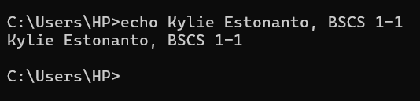

**Figure A1. Displaying a name using the** **echo** **command**

3. Press Windows + R, type powershell, and press Enter. Type the same echo command, but

put the text in quotation marks: echo "Juan Dela Cruz, BSCS 1-1". PowerShell treats the
comma as a list separator without them.

**Echoing a Name in PowerShell**

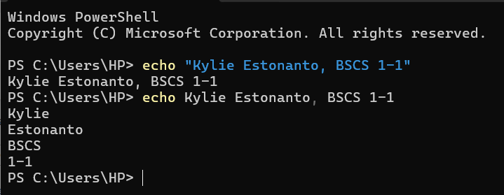

**Figure A2. Echoing a name in PowerShell with and without quotation marks**

**[Answer] A-Q1.** Compare the two prompts. What is different, and what does each part of the Command Prompt prompt mean?

PowerShell has PS at the beginning to show that PowerShell is being used. In the Command Prompt prompt, C: is the drive, \Users\HPshows the current directory, and > shows where we can enter a command. PowerShell also shows the current directory but has PS before it.

---

## Page 3

***Part B: Inspect Your System (Command Prompt)***

Use the Command Prompt window for Parts B to D.

1. Run these commands one at a time: whoami, then hostname, then ver.

**Checking System Information**

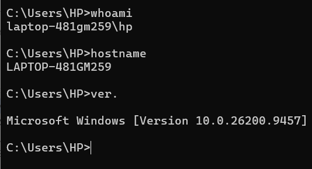

**Figure B1.  System information using** **whoami**,**hostname**, **and** **ver.** **commands**

2. Run the command below. It may take 10 to 30 seconds.

**Filtering System Information**

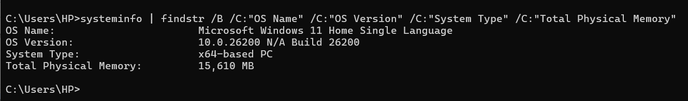

**Figure B2. Filtered system information using the** **systeminfo** **and** **findstr**
**commands**

systeminfo | findstr /B /C:"OS Name" /C:"OS Version" /C:"System Type"
/C:"Total Physical Memory"

---

## Page 4

3. Run ipconfig. Find the adapter that shows an IPv4 Address.

**Checking the IPv4 Address**

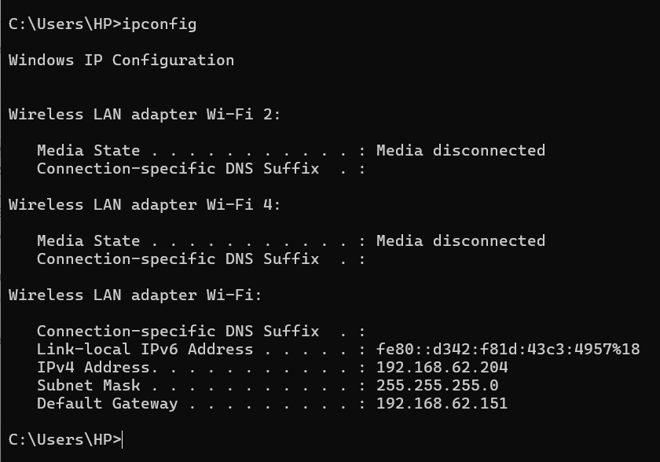

**Figure B3. Finding an adapter with an IPv4 address using** **ipconfig**

**[Answer] B-Q1.** Complete this table in your documentation using your results:

<table>
  <tr>
    <th></th>
    <th>Item</th>
    <th></th>
    <th></th>
    <th>Your result</th>
    <th></th>
  </tr>
  <tr>
    <td>Logged-in account (whoami)</td>
    <td></td>
    <td></td>
    <td>laptop-481gm259\hp</td>
    <td></td>
    <td></td>
  </tr>
  <tr>
    <td>Computer name (hostname)</td>
    <td></td>
    <td></td>
    <td>LAPTOP-481GM259</td>
    <td></td>
    <td></td>
  </tr>
  <tr>
    <td>OS name</td>
    <td></td>
    <td></td>
    <td>Microsoft Windows 11 Home Single Language</td>
    <td></td>
    <td></td>
  </tr>
  <tr>
    <td>OS version</td>
    <td></td>
    <td></td>
    <td>10.0.26200 N/A Build 26200</td>
    <td></td>
    <td></td>
  </tr>
  <tr>
    <td>System type (x64 or ARM)</td>
    <td></td>
    <td></td>
    <td>x64-based PC</td>
    <td></td>
    <td></td>
  </tr>
  <tr>
    <td>Total physical memory (RAM)</td>
    <td></td>
    <td></td>
    <td>15,610 MB</td>
    <td></td>
    <td></td>
  </tr>
  <tr>
    <td>IPv4 address</td>
    <td></td>
    <td></td>
    <td>192.168.62.204</td>
    <td></td>
    <td></td>
  </tr>
</table>

**[Answer] B-Q2** The | symbol in step 2 is called a **pipe**. Run systeminfo alone and compare. In
your own words, what did | findstr do?

Without a pipe, the output isERROR: Invalid argument/option – ‘findstr’.
Type “SYSTEMINFO /?” for usage.With the pipe,findstrsearches through the output of systeminfo and displays the lines that match the specified terms. In this case, it shows the OS name and version, system type, and total physical memory.

---

## Page 5

***Part C: Build a Folder Structure***

1. Go to your user folder and create the lab folders:

cd %USERPROFILE% 
mkdir CC101-Lab 
cd CC101-Lab 
mkdir Notes Projects Screenshots

2. Create a text file about yourself (use your own details):

echo Name: Juan Dela Cruz > profile.txt 
echo Section: BSCS 1-1 >> profile.txt 
echo Favorite app: YouTube >> profile.txt 
type profile.txt 

**Creating Lab Folders and a Text File**

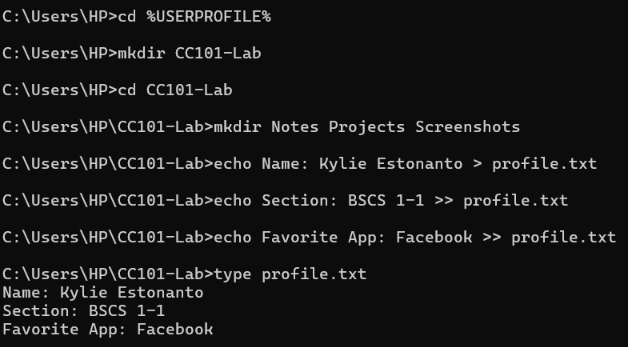

**Figure C1**.**Creating lab folders and a personal text file in the user fold**

---

## Page 6

3. Run tree /F to display your folder structure.

**Displaying the Folder Structure**

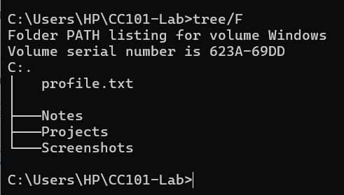

**Figure C2. Displaying the folder structure and files using the** **tree /F** **command**

4. Open File Explorer, go to C:\Users\(your account)\CC101-Lab, and open profile.txt in Notepad.

**Opening the Text File in Notepad**

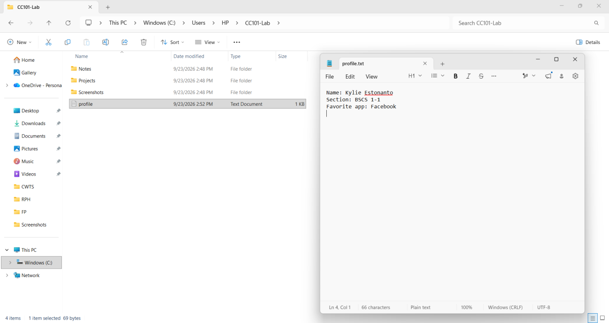

**Figure C3. Viewing****profile.txt****in Notepad alongside its file directory in File**
**Explorer**

**[Answer] C-Q1.** What would happen if you used > instead of >> in the second echo line? Test it
on a new file (test.txt) and explain.

The first line will not appear because using > on the second echo line will overwrite the
contents of the file. I assume that this happens because > replaces the existing content, while >>
adds the new line after the existing content. Therefore, using > on the second line will leave the
second echo line in the file.

---

## Page 7

***Part D: Copy, Rename, and Delete Files***

copy profile.txt Notes\profile-copy.txt 
cd Notes 
ren profile-copy.txt about-me.txt 
echo This file will be deleted > temp.txt 
dir 
del temp.txt 
dir 
cd . . 
tree /F

**Copying and Renaming Files**

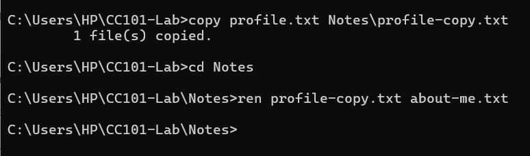

**Figure D1. Copying and renaming files using Command Prompt**

---

## Page 8

**Deleting Files and Verifying the Folder Structure**

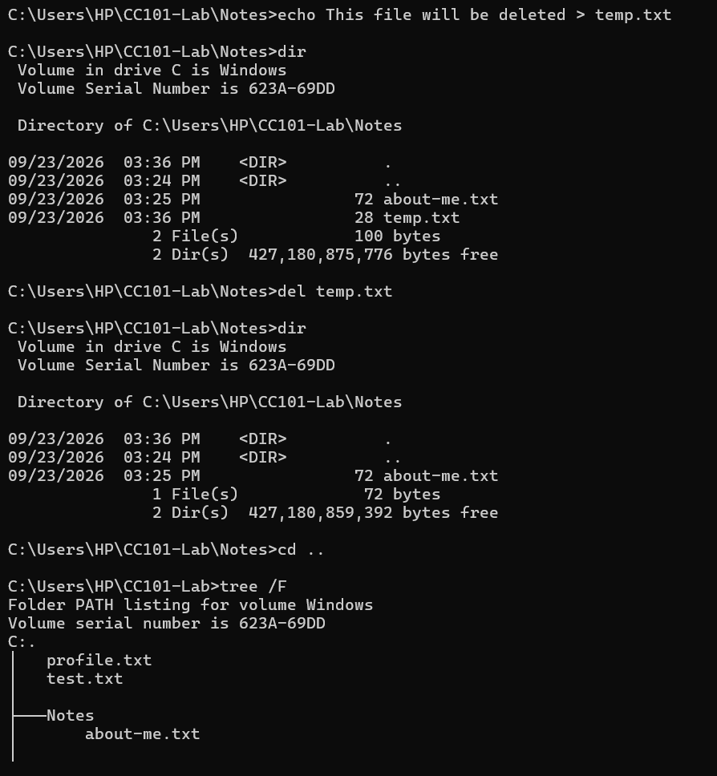

**Figure D2. Deleting files and displaying the updated folder structure using****tree /F**

**[Answer] D-Q1.** After del temp.txt, check your Recycle Bin. Is temp.txt there? What does this tell you about deleting files from the command line?

No. Because the del command directly deletes the file instead of sending it to the Recycle Bin. This tells me that deleting files from the command line can remove them directly, so I need to be careful when using thedelcommand.

---

## Page 9

***Part E: Explore PowerShell***

Switch to the PowerShell window.

1. Go to your lab folder and list and read its files:

cd $HOME\CC101-Lab 
Get-ChildItem 
Get-Content profile.txt 
$PSVersionTable

**Reading Files in the Lab Folder**

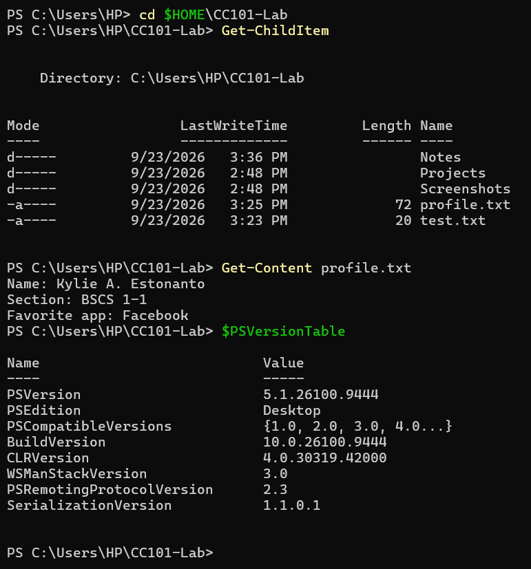

**Figure E1. Listing and reading files using** **Get-ChildItem** **and** **Get-Content**

---

## Page 10

2. Run Get-Help Get-ChildItem. If PowerShell asks whether to run Update-Help, type N and press Enter.

**Viewing Command Help**

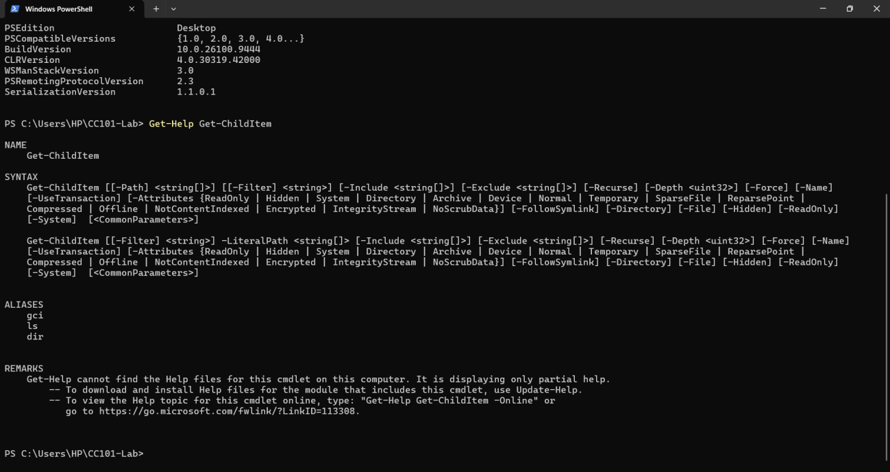

**Figure E2. Viewing help for** **Get-ChildItem** **using** **Get-Help**

3. Take the **last three digits of your student ID number** (for example, 2025-00347 → 347).

Convert it with PowerShell:

[Convert]::ToString(347, 2) 
[Convert]::ToString(347, 8) 
'{0:X}' -f 347

**Converting Student ID Number (26126514 → 514)**

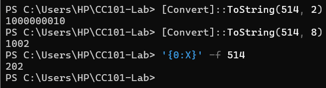

**Figure E3. Converting the last three digits of the student ID number**

**[Answer] E-Q1.** Write your number in decimal, binary, octal, and hexadecimal. Keep this; you will verify it by hand in Week 5.

Decimal – 514

Binary – 1000000010

Octal – 1002

Hexadecimal - 202

---

## Page 11

***Part F: Discover a New Command***

1. In Command Prompt, type help to see a list of commands.

2. Choose **one** command that was **not** taught in this lesson and is safe to run (for example: date /t, time /t, tasklist, vol, or color 0A).

3. Read its help with command /? (for example, tasklist /?), then run it.

**Viewing** **DATE** **Command Help**

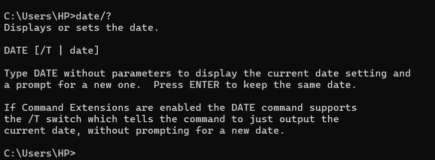

**Figure F1. Viewing help for the****DATE****command**

**Displaying the Current Date**

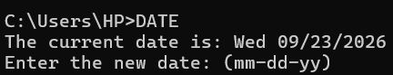

**Figure F2. Displaying the current date using the****DATE****command**

**[Answer] F-Q1.** What does your chosen command do, and when would it be useful?

The DATE command is used when you want to view or adjust the current date of the system. It can be useful when the computer has an incorrect date and you need to correct it.

***Commands Learned Table***

<table>
  <tr>
    <th></th>
    <th>Command</th>
    <th></th>
    <th></th>
    <th>Shell</th>
    <th></th>
    <th></th>
    <th>What it does</th>
    <th></th>
  </tr>
  <tr>
    <td>echo name, section</td>
    <td></td>
    <td></td>
    <td>Command Prompt</td>
    <td></td>
    <td></td>
    <td>Displays the name and section in the terminal.</td>
    <td></td>
    <td></td>
  </tr>
  <tr>
    <td>whoami</td>
    <td></td>
    <td></td>
    <td>Command Prompt</td>
    <td></td>
    <td></td>
    <td>Displays the logged in username of the account.</td>
    <td></td>
    <td></td>
  </tr>
  <tr>
    <td>hostname</td>
    <td></td>
    <td></td>
    <td>Command Prompt</td>
    <td></td>
    <td></td>
    <td>Displays the name of the computer.</td>
    <td></td>
    <td></td>
  </tr>
  <tr>
    <td>ver.</td>
    <td></td>
    <td></td>
    <td>Command Prompt</td>
    <td></td>
    <td></td>
    <td>Displays the Windows version.</td>
    <td></td>
    <td></td>
  </tr>
  <tr>
    <td>cd ..</td>
    <td></td>
    <td></td>
    <td>Command Prompt</td>
    <td></td>
    <td></td>
    <td>Moves the current folder to the parent folder.</td>
    <td></td>
    <td></td>
  </tr>
  <tr>
    <td>mkdir CC101-Lab</td>
    <td></td>
    <td></td>
    <td>Command Prompt</td>
    <td></td>
    <td></td>
    <td>Creates a folder named CC101-Lab in the current folder.</td>
    <td></td>
    <td></td>
  </tr>
  <tr>
    <td>DATE</td>
    <td></td>
    <td></td>
    <td>Command Prompt</td>
    <td></td>
    <td></td>
    <td>Allows you to change the current date.</td>
    <td></td>
    <td></td>
  </tr>
  <tr>
    <td>del</td>
    <td></td>
    <td></td>
    <td>Command Prompt</td>
    <td></td>
    <td></td>
    <td>Deletes files from the current directory.</td>
    <td></td>
    <td></td>
  </tr>
  <tr>
    <td>ren</td>
    <td></td>
    <td></td>
    <td>Command Prompt</td>
    <td></td>
    <td></td>
    <td>Renames a file or folder.</td>
    <td></td>
    <td></td>
  </tr>
  <tr>
    <td>Get-ChildItem</td>
    <td></td>
    <td></td>
    <td>PowerShell</td>
    <td></td>
    <td></td>
    <td>Displays files and folders from the current directory.</td>
    <td></td>
    <td></td>
  </tr>
  <tr>
    <td>cls</td>
    <td></td>
    <td></td>
    <td>Command Prompt</td>
    <td></td>
    <td></td>
    <td>Clears all of the contents in the Command Prompt screen.</td>
    <td></td>
    <td></td>
  </tr>
  <tr>
    <td>systeminfo</td>
    <td></td>
    <td></td>
    <td>Command Prompt</td>
    <td></td>
    <td></td>
    <td>Displays detail information about the computer.</td>
    <td></td>
    <td></td>
  </tr>
  <tr>
    <td>findstr</td>
    <td></td>
    <td></td>
    <td>Command Prompt</td>
    <td></td>
    <td></td>
    <td>Displays lines that matches the searched words.</td>
    <td></td>
    <td></td>
  </tr>
  <tr>
    <td>ipconfig</td>
    <td></td>
    <td></td>
    <td>Command Prompt</td>
    <td></td>
    <td></td>
    <td>Shows the network configuration information, including IP addresses.</td>
    <td></td>
    <td></td>
  </tr>
  <tr>
    <td>tree</td>
    <td></td>
    <td></td>
    <td>Command Prompt</td>
    <td></td>
    <td></td>
    <td>Shows the folders in a tree-like structure</td>
    <td></td>
    <td></td>
  </tr>
  <tr>
    <td>Get-Content</td>
    <td></td>
    <td></td>
    <td>PowerShell</td>
    <td></td>
    <td></td>
    <td>Displays the file contents.</td>
    <td></td>
    <td></td>
  </tr>
  <tr>
    <td>$PSVersionTable</td>
    <td></td>
    <td></td>
    <td>PowerShell</td>
    <td></td>
    <td></td>
    <td>Displays the installed PowerShell version.</td>
    <td></td>
    <td></td>
  </tr>
  <tr>
    <td>Get-Help</td>
    <td></td>
    <td></td>
    <td>PowerShell</td>
    <td></td>
    <td></td>
    <td>Shows help about PowerShell commands.</td>
    <td></td>
    <td></td>
  </tr>
  <tr>
    <td>help</td>
    <td></td>
    <td></td>
    <td>Command Prompt</td>
    <td></td>
    <td></td>
    <td>Shows a list of Command Prompt commands.</td>
    <td></td>
    <td></td>
  </tr>
  <tr>
    <td>[Convert]::ToString( …)</td>
    <td></td>
    <td></td>
    <td>PowerShell</td>
    <td></td>
    <td></td>
    <td>Converts a number to another number system.</td>
    <td></td>
    <td></td>
  </tr>
  <tr>
    <td>‘{0:X}’ -f …</td>
    <td></td>
    <td></td>
    <td>PowerShell</td>
    <td></td>
    <td></td>
    <td>Converts a number to hexadecimal.</td>
    <td></td>
    <td></td>
  </tr>
  <tr>
    <td>copy</td>
    <td></td>
    <td></td>
    <td>Command Prompt</td>
    <td></td>
    <td></td>
    <td>Copies a file to another file location.</td>
    <td></td>
    <td></td>
  </tr>
  <tr>
    <td>type</td>
    <td></td>
    <td></td>
    <td>Command Prompt</td>
    <td></td>
    <td></td>
    <td>Shows what is inside of a text file.</td>
    <td></td>
    <td></td>
  </tr>
  <tr>
    <td>dir</td>
    <td></td>
    <td></td>
    <td>Command Prompt</td>
    <td></td>
    <td></td>
    <td>Shows the contents of the current directory.</td>
    <td></td>
    <td></td>
  </tr>
</table>

***Part G: Reflection***

**[Answer]** Answer in 3 to 5 sentences each:

1. **G-Q1.** Which task in this activity was faster in the CLI than in the GUI? Which was easier in the GUI? Explain why.

When checking system information, using the CLI can be faster than using the
GUI because you only need to type a command instead of searching through
different settings or menus. It allows you to access the information directly without going through multiple options. On the other hand, some tasks can be easier in the GUI because the options are displayed visually and are easier to navigate, especially for beginners.

2. **G-Q2.** What error did you encounter (if any), what caused it, and how did you fix it?

I encountered an error when using the ren profile.txt about-me.txt 
command because it did not work on my first attempt. I repeated the command and it worked, so I assumed that I had made a typographical error the first time. After that, I was able to continue the activity without any further problems.

3. **G-Q3.** Give one real-world job or situation in computing where knowing the command line would be important.

Knowing the command line is important for technical assistants and IT support professionals because they may use it to configure operating systems and set up computers. I once encountered a Technical Assistant who used the command line while configuring my operating system and setting up my new laptop. It can be quick and efficient once the commands are understood, even though they may look complex at first. This can make tasks such as configuring a laptop more efficient and easier to manage.

**Documentation and Submission**

Submit one PDF that records what you did, what the computer showed, and what you learned. Someone reading it should be able to repeat your work.

**Required Contents (in this order)**

1. **Cover page:** activity title, your full name, student ID, section, date performed, and instructor's name.

2. **Introduction** (3 to 5 sentences): what the command line is and the purpose of this activity, in your own words.

3. **Procedure and results, Parts A to F:** for each part, a short heading, the commands you typed, the labeled screenshots, and your answers to that part's [Answer] questions.

4. **Commands learned table:** every command you used and what it does, in your own words.

5. **Reflection:** your answers to G-Q1 to G-Q3.

 ***Formatting Rules***
<table>
<tr>
    <th></th>
    <th>Item</th>
    <th></th>
    <th></th>
    <th>Requirement</th>
    <th></th>
  </tr>
  <tr>
    <td>File type</td>
    <td></td>
    <td></td>
    <td>PDF (write in Word or Google Docs, then export as PDF)</td>
    <td></td>
    <td></td>
  </tr>
  <tr>
    <td>File name</td>
    <td></td>
    <td></td>
    <td>CC101 CLI-Lab Lastname Firstname.pdf _ _ _</td>
    <td></td>
    <td></td>
  </tr>
  <tr>
    <td>Font</td>
    <td></td>
    <td></td>
    <td>Arial or Calibri, 11 pt; commands in Consolas or Courier New</td>
    <td></td>
    <td></td>
  </tr>
  <tr>
    <td>Screenshots</td>
    <td></td>
    <td></td>
    <td>Crop to the terminal window; text must be readable. Label each one below the image, e.g., &quot;Figure B2. Filtered systeminfo output&quot;</td>
    <td></td>
    <td></td>
  </tr>
  <tr>
    <td>Personal details</td>
    <td></td>
    <td></td>
    <td>Your own name, section, and student ID must appear in Figures A1, C1, and E3</td>
    <td></td>
    <td></td>
  </tr>
  <tr>
    <td>Total screenshots</td>
    <td></td>
    <td></td>
    <td>16 (A1–A2, B1–B3, C1–C3, D1–D2, E1–E3, F1–F2)</td>
    <td></td>
    <td></td>
  </tr>
  </table>

***Sample Commands Learned Table***

<table>
<tr>
    <th></th>
    <th>Command</th>
    <th></th>
    <th></th>
    <th>Shell</th>
    <th></th>
    <th></th>
    <th>What it does</th>
    <th></th>
  </tr>
<tr>
    <td>mkdir Notes</td>
    <td></td>
    <td></td>
    <td>Command Prompt</td>
    <td></td>
    <td></td>
    <td>Creates a folder named Notes in the current folder</td>
    <td></td>
    <td></td>
  </tr>
  <tr>
    <td>type profile.txt</td>
    <td></td>
    <td></td>
    <td>Command Prompt</td>
    <td></td>
    <td></td>
    <td>Displays the contents of profile.txt</td>
    <td></td>
    <td></td>
  </tr>
</table>

---

## Page 12

***Submission***

•
Upload the PDF to the activity page in the course LMS before the deadline your
instructor sets.

•
Outputs must be your own work. Identical screenshots or answers will be treated as
plagiarism under the class policy.

•
Keep your CC101-Lab folder; later activities may build on it.

 **Grading Rubric** 
The documentation is scored out of 100 points and counts under Laboratory: Project.  

<table>
  <tr>
    <th>Criterion</th>
    <th></th>
    <th>Point</th>
    <th></th>
    <th>Full marks</th>
    <th>Partial marks</th>
    <th>Low marks</th>
  </tr>
  <tr>
    <td></td>
    <td></td>
    <td>s</td>
    <td></td>
    <td></td>
    <td></td>
    <td></td>
  </tr>
  <tr>
    <td>Completeness of procedure</td>
    <td>30</td>
    <td></td>
    <td></td>
    <td>All 16 labeled, readable screenshots; every part A to F documented</td>
    <td>1 to 4 screenshots missing or unreadable</td>
    <td>5 or more screenshots missing</td>
  </tr>
  <tr>
    <td>Accuracy of results</td>
    <td>20</td>
    <td></td>
    <td></td>
    <td>System-information table complete; commands and conversions correct and personalized</td>
    <td>Minor errors or 1 to 2 missing values</td>
    <td>Many errors, or results not the student&#x27;s own</td>
  </tr>
  <tr>
    <td>Answers to guide questions (A to F)</td>
    <td>20</td>
    <td></td>
    <td></td>
    <td>Correct, clear, in the student&#x27;s own words</td>
    <td>Mostly correct but brief or vague</td>
    <td>Missing, incorrect, or copied</td>
  </tr>
  <tr>
    <td>Reflection (G-Q1 to G-Q3)</td>
    <td>15</td>
    <td></td>
    <td></td>
    <td>Specific, honest, and linked to the activity</td>
    <td>General statements with few specifics</td>
    <td>Missing or off-topic</td>
  </tr>
  <tr>
    <td>Organization and formatting</td>
    <td>15</td>
    <td></td>
    <td></td>
    <td>Follows the required order, naming, and formatting rules; commands learned table complete</td>
    <td>Some rules not followed</td>
    <td>Disorganized; wrong file type or name</td>
  </tr>
  <tr>
    <td>Total</td>
    <td>100</td>
    <td></td>
    <td></td>
    <td></td>
    <td></td>
    <td></td>
  </tr>
</table>

---
