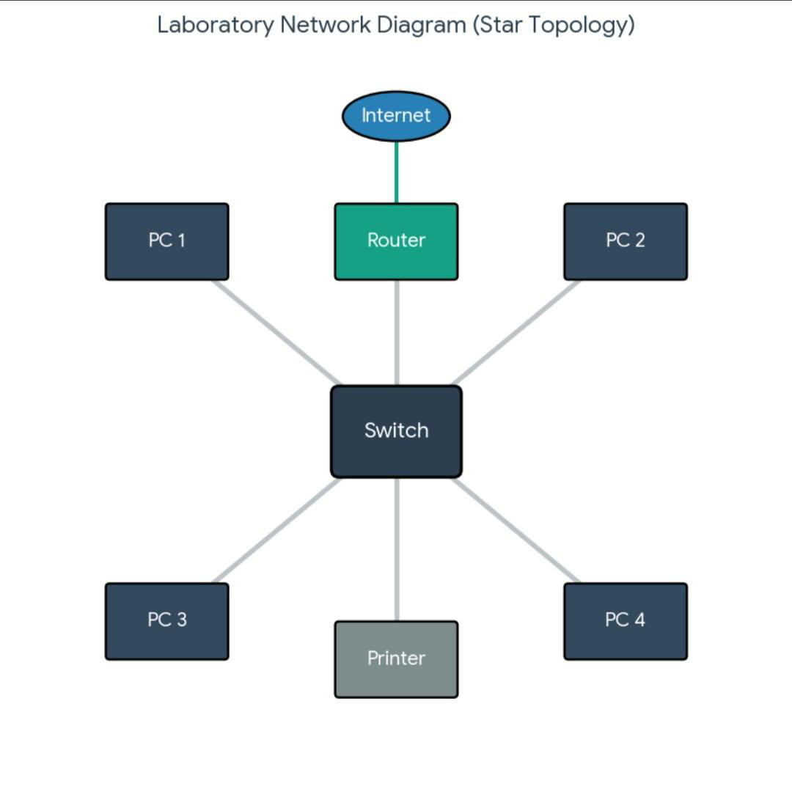

# ACTIVITY 5 - KNOW YOUR NETWORKS

## Page 1

Republic of the Philippines 
<strong>Sorsogon State University</strong> 
<strong>COLLEGE OF INFORMATION</strong> 
<strong>AND COMMUNICATIONS TECHNOLOGY</strong> 
<strong>Bulan Campus</strong> 
<em>Zone 8, Bulan, Sorsogon</em> 
Tel. No.; 056 311-0103; Email Address:cict@sorsu.edu.ph

<strong>CC 101 – Introduction to Computing</strong> 
Laboratory Worksheet No. 3  |  Week 6: Computer Networks & the Internet (CO4) 
<strong>“Know Your Network Settings”: Exploring Windows 11 Network Configuration Tools</strong>

<table>
  <tr>
    <td><strong>Name:</strong> Kylie A. Estonanto</td>
    <td><strong>Block:</strong> BSCS 1-1</td>
  </tr>
  <tr>
    <td><strong>Computer Unit Used (Desktop/Laptop, brand):</strong> HP</td>
    <td><strong>Date:</strong> 10.14.26</td>
  </tr>
</table>

 **I.  Objectives**

At the end of this activity, you should be able to:

• Locate network adapter information using Windows 11 Settings, the Control Panel, Command Prompt (CMD), and PowerShell.

• Use **ipconfig**, **getmac**, **hostname**, **ping**, **netstat**, **route print**, and **systeminfo** in CMD, and **Get-NetAdapter**, **Get-NetIPAddress**, and **Test-Connection** in PowerShell.

• Interpret a sample **ipconfig /all** output from a networked computer: identify its IP address, subnet mask, default gateway, and DNS servers, and classify the address as public or
private.

• Relate each tool and finding to the layer of the OSI model where it works.

• Design a simple network and IP address plan for the computer laboratory.

**II.  Materials Needed**

• A computer running Windows 11 (a network or Internet connection is **not** required for this
activity)

• This worksheet (printed copy, or the digital file to fill out and submit)

• Week 6 lecture notes, for reference on IP addresses, protocols, the OSI model, and network
devices

**III.  Background**

A computer does not need to be connected to a network to have network settings. Every PC has
one or more **network adapters** (NICs), each with a permanent **MAC address**, and Windows always runs the TCP/IP software, including the **loopback** address 127.0.0.1 (IPv4) and ::1 (IPv6) that the computer uses to talk to itself. Windows 11 lets you inspect these settings in four places: the **Settings** app, the classic **Control Panel**, **Command Prompt (CMD)**, and **PowerShell**. In this activity, you will explore all four on your own unit, observe how Windows behaves when no network is available, and then analyze a sample configuration taken from a computer that*is*connected to a network.

**IV.  Procedure**

**Reminder:** This is a *viewing* activity. Do not change, disable, or reset any network setting. Close every dialog with **Cancel**. Record values exactly as Windows shows them.

***Part A – Windows 11 Settings***

1. Press **Windows + I** to open Settings, then click **Network & internet**. Write down the
connection status shown at the top of the page (for example, “Not connected”).

2. Click **Advanced network settings**. Under **Network adapters**, note every adapter listed (for example, Ethernet, Wi-Fi, Bluetooth Network Connection) and whether each one is enabled
or disconnected.

---

## Page 2

3. Scroll down and click **Hardware and connection properties**. For each adapter, record its **Name**, **Description**, **Physical address (MAC)**, and **Status** in **Table 1**.

***Part B – Control Panel (Network Connections)***

4. Press **Windows + R**, type **ncpa.cpl**, and press **Enter**. This opens the classic **Network Connections** window. A red X on an icon means the adapter has no network connection.

5. Right-click your **Ethernet** adapter and choose **Properties**. List the items checked under “This connection uses the following items” in **Table 2**.

6. Select **Internet Protocol Version 4 (TCP/IPv4)** and click **Properties**. Record whether the computer is set to **Obtain an IP address automatically** (DHCP) or **Use the following IP address** (static), and the same for DNS. Click **Cancel**, then **Cancel** again. Do not change anything.

***Part C – Command Prompt (CMD)***

7. Press the **Windows key**, type **cmd**, and press **Enter**. Run each command below, one at a time, and record the results in **Table 3**.

**hostname**

**getmac /v**

**ipconfig /all**

Tip: For a disconnected adapter, **ipconfig /all**shows “Media disconnected” and no IPv4
address, but it still shows the Description and Physical Address.

8. Test the computer’s own TCP/IP software using the loopback address. Record whether you
got replies and the time. For **ping localhost**, note the address that replied.

**ping 127.0.0.1**

**ping localhost**

9. Now observe what happens when there is no network. Record the **exact** message each
command displays.

**ping 8.8.8.8**

**nslookup google.com**

10. View the ports your computer is listening on and its routing table. In Table 3, record three LISTENING local addresses with their port numbers, and the Netmask shown for the Network
Destination 127.0.0.0.

**netstat -an | findstr LISTENING**

**route print -4**

11. Run the command below. It may take a few seconds. Scroll to **Network Card(s)** and
record how many network cards are installed and the status of each.

**systeminfo**

***Part D – PowerShell***

12. Right-click the **Start** button and choose **Terminal** (or press the **Windows key**, type **PowerShell**, and press **Enter**). Run each command below and record the results in **Table 4**.

**Get-NetAdapter**

**Get-NetIPAddress -AddressFamily IPv4 | Format-Table InterfaceAlias, IPAddress,**
**PrefixLength**

**Test-Connection 127.0.0.1 -Count 4**

**Get-NetTCPConnection -State Listen | Select-Object -First 5 LocalAddress, LocalPort**

Tip: PowerShell commands follow a Verb-Noun pattern (Get-NetAdapter = “get the network
adapters”). Compare each result with the matching CMD command from Part C.

---

## Page 3

***Part E – Analyze a Networked Computer***

13. The output below was taken from a laboratory computer that **is** connected to a
network. Study it, then complete **Table 5**.

**Sample Output 1.** **ipconfig /all** (excerpt) from a networked PC

<table>
  <tr>
    <td><strong>Host Name</strong></td>
    <td>CICT-LAB-PC07</td> 
  </tr>
  <tr>
    <th colspan="2">Ethernet adapter Ethernet</th>
  </tr>
  <tr>
    <td><strong>Description</strong></td>
    <td>Realtek PCIe GbE Family Controller</td>
  </tr>
  <tr>
    <td><strong>Physical Address</strong></td>
    <td>3C-52-82-A1-7F-09</td>
  </tr>
  <tr>
    <td><strong>DHCP Enabled</strong></td>
    <td>Yes</td>
  </tr>
  <tr>
    <td><strong>Link-local IPv6 Address</strong></td>
    <td>fe80::8c2d:4a1f:93b2:61e5%12(Preferred)</td>
  </tr>
  <tr>
    <td><strong>IPv4 Address</strong></td>
    <td>192.168.10.37(Preferred)</td>
  </tr>
  <tr>
    <td><strong>Subnet Mask</strong></td>
    <td>255.255.255.0</td>
  </tr>
  <tr>
    <td><strong>Lease Obtained</strong></td>
    <td>Wednesday, October 14, 2026 8:02:15 AM</td>
  </tr>
  <tr>
    <td><strong>Lease Expires</strong></td>
    <td>Thursday, October 15, 2026 8:02:15 AM</td>
  </tr>
  <tr>
    <td><strong>Default Gateway</strong></td>
    <td>192.168.10.1</td>
  </tr>
  <tr>
    <td><strong>DHCP Server</strong></td>
    <td>192.168.10.1</td>
  </tr>
  <tr>
    <td><strong>DNS Servers</strong></td>
    <td>192.168.10.1, 8.8.8.8</td>
  </tr>
</table> 

***Part F – Design a Network for Our Laboratory***

14. Our laboratory does not yet have a network. In the box after Table 5, draw a simple **star topology** network for it. Include at least **four PCs**, one **switch**, one **router**(default gateway), one **printer**, and the **ISP / Internet**. Use lines to show connections.

15. Assign each device a private IPv4 address from the network **192.168.10.0/24**, using **192.168.10.1** for the router. Label each device in your drawing and complete the **IP Address Plan** (Table 6).

***Part G – Optional / Bonus***

16. In CMD, run **type C:\Windows\System32\drivers\etc\hosts** to *view* (not edit) the hosts
file. In one or two sentences, explain what this file is for and how it relates to DNS.

**V.  Data and Findings**

***Table 1. Network Adapters in Settings (Part A)***

Connection status shown on the Network & internet page:
<u>Connected</u>

<table>
  <tr>
    <th>Adapter Name</th>
    <th>Description</th>
    <th>Physical Address (MAC)</th>
    <th>Status</th>
  </tr>
  <tr>
    <td>McAfee VPN</td>
    <td>TAP-Windows Adapter V9</td>
    <td>00:ff:ad:79:70:11</td>
    <td>Not Operational</td>
  </tr>
  <tr>
    <td>Wi-Fi 2</td>
    <td>Realtek 8852BE-VT Wireless LAN WiFi 6 PCI-E NIC #2</td>
    <td>56:2e:91:1e:c1:de</td>
    <td>Not Operational</td>
  </tr>
  <tr>
    <td>Ethernet</td>
    <td>Realtek USB GbE Family Controller</td>
    <td>0c:37:96:55:2f:79</td>
    <td>Not Present</td>
  </tr>
  <tr>
    <td>Bluetooth Network Connection</td>
    <td>Bluetooth Device (Personal Area Network)</td>
    <td>50:2e:91:1e:c1:df</td>
    <td>Not Operational</td>
  </tr>
</table>

---

## Page 4

***Table 2. Adapter Properties (Part B)***

<table>
  <tr>
    <th>Items Checked Under “This connection uses the following items”</th>
    <th>Item Checked (continued)</th>
  </tr>
  <tr>
    <td>Client for Microsoft Networks</td>
    <td>Nested Network Virtualization</td>
  </tr>
  <tr>
    <td>File and Printer Sharing for Microsoft Networks</td>
    <td>Internet Protocol Version 4 (TCP/IPv4)</td>
  </tr>
  <tr>
    <td>QoS Packet Scheduler</td>
    <td>Microsoft LLDP Protocol Driver</td>
  </tr>
  <tr>
    <td>Bridge Driver</td>
    <td>Link-Layer Topology Discovery Responder</td>
  </tr>
</table>

<table>
  <tr>
    <th>TCP/IPv4 Setting</th>
    <th>Automatic or Static?</th>
  </tr>
  <tr>
    <td>IP address</td>
    <td>Automatic</td>
  </tr>
  <tr>
    <td>DNS server address</td>
    <td>Automatic</td>
  </tr>
</table>

---

## Page 5

***Table 3. Command Prompt Results (Part C)***

<table>
  <tr>
    <th>Command / Item</th>
    <th>Your Findings</th>
    <th>OSI Layer</th>
  </tr>
  <tr>
    <td>hostname</td>
    <td>LAPTOP-481GM259</td>
    <td>Layer 7</td>
  </tr>
  <tr>
    <td>getmac /v: MAC address and Transport Name</td>
    <td>MAC address: 50-2E-91-1E-C1-DE Transport Name: Media disconnected</td>
    <td>Layer 2</td>
  </tr>
  <tr>
    <td>ipconfig /all: Media State of Ethernet</td>
    <td>Media disconnected</td>
    <td>—</td>
  </tr>
  <tr>
    <td>ipconfig /all: DHCP Enabled</td>
    <td>Yes</td>
    <td>—</td>
  </tr>
  <tr>
    <td>ping 127.0.0.1: replies and time</td>
    <td>bytes=32, time&lt;1ms, TTL=128</td>
    <td>Layer 3</td>
  </tr>
  <tr>
    <td>ping localhost: address that replied</td>
    <td>::1</td>
    <td>—</td>
  </tr>
  <tr>
    <td>ping 8.8.8.8: exact message</td>
    <td>PING: transmit failed. General failure.</td>
    <td>Layer 3</td>
  </tr>
  <tr>
    <td>nslookup google.com: exact message</td>
    <td>*** Default servers are not available Server: UnKnown Address: 127.0.0.1 *** UnKnown can&#x27;t find google.com: No response from server</td>
    <td>Layer 7</td>
  </tr>
  <tr>
    <td>netstat -an: three LISTENING addresses:ports</td>
    <td>0.0.0.0:135 0.0.0.0:445 0.0.0.0:5040</td>
    <td>Layer 4</td>
  </tr>
  <tr>
    <td>route print -4: Netmask for 127.0.0.0</td>
    <td>255.0.0.0</td>
    <td>—</td>
  </tr>
  <tr>
    <td>systeminfo: number of NICs and status</td>
    <td>2 NIC(s) Installed. Media disconnected</td>
    <td>—</td>
  </tr>
</table>

***Table 4. PowerShell Results (Part D)***

<table>
  <tr>
    <th>Command</th>
    <th>What It Showed</th>
    <th>Matches CMD? (Y/N)</th>
  </tr>
  <tr>
    <td>Get-NetAdapter: Name, Status, MacAddress, LinkSpeed</td>
    <td>Name: Wi-Fi Status: Disconnected MacAddress: 50-2E-91-1E-C1-DE LinkSpeed: 0 bps</td>
    <td>Y</td>
  </tr>
  <tr>
    <td>Get-NetIPAddress: IPv4 addresses and PrefixLength</td>
    <td>IPv4 address: 127.0.0.1 PrefixLength: 8</td>
    <td>Y</td>
  </tr>
  <tr>
    <td>Test-Connection 127.0.0.1: result</td>
    <td>Source: LAPTOP-481... Destination: 127.0.0.1 IPv4 address: 127.0.0.1 IPv6 address: ::1 Bytes: 32 Time(ms): 0</td>
    <td>Y</td>
  </tr>
  <tr>
    <td>Get-NetTCPConnection - State Listen: two LocalAddress:LocalPort pairs</td>
    <td>:: and 49669 127.0.0.1 and 7768</td>
    <td>Y</td>
  </tr>
</table>

***Table 5. Sample Output Analysis (Part E)***

<table>
  <tr>
    <th>Question</th>
    <th>Your Answer</th>
  </tr>
  <tr>
    <td>IPv4 address of PC07</td>
    <td>192.168.10.37</td>
  </tr>
  <tr>
    <td>Subnet mask (and its /prefix)</td>
    <td>255.255.255.0 (/24)</td>
  </tr>
  <tr>
    <td>Default gateway, and what device it usually is</td>
    <td>192.168.10.1 (Router)</td>
  </tr>
  <tr>
    <td>DNS servers</td>
    <td>192.168.10.1 and 8.8.8.8</td>
  </tr>
  <tr>
    <td>Was the address assigned by DHCP or set manually? How do you know?</td>
    <td>DHCP Assigned. Because “DHCP Enabled” says Yes.</td>
  </tr>
  <tr>
    <td>Public or private? Which RFC 1918 range?</td>
    <td>Private address. Class C range (192.168.0.0 – 192.168.255.255).</td>
  </tr>
  <tr>
    <td>IPv4 address of PC07 in binary (four octets)</td>
    <td>11000000.10101000.00001010.00100101</td>
  </tr>
  <tr>
    <td>MAC address, and the OSI layer where it is used</td>
    <td>3C-52-82-A1-7F-09, Data Link Layer (Layer 2)</td>
  </tr>
  <tr>
    <td>How long is the DHCP lease?</td>
    <td>24 hours</td>
  </tr>
  <tr>
    <td>If the DHCP server failed, what kind of address would PC07 assign itself?</td>
    <td>An APIPA address, which always starts with 169.254.X.X</td>
  </tr>
</table>

---

## Page 6

***Figure 1. Proposed Laboratory Network Diagram (Part F)***

*Draw or paste your diagram here.*

***Table 6. IP Address Plan (Part F)***

<table>
  <tr>
    <th>Device</th>
    <th>IPv4 Address</th>
    <th>Subnet Mask</th>
    <th>Default Gateway</th>
  </tr>
  <tr>
    <td>Router (gateway)</td>
    <td>192.168.10.1</td>
    <td>255.255.255.0</td>
    <td>—</td>
  </tr>
  <tr>
    <td>PC 1</td>
    <td>192.168.10.2</td>
    <td>255.255.255.0</td>
    <td>192.168.10.1</td>
  </tr>
  <tr>
    <td>PC 2</td>
    <td>192.168.10.3</td>
    <td>255.255.255.0</td>
    <td>192.168.10.1</td>
  </tr>
  <tr>
    <td>PC 3</td>
    <td>192.168.10.4</td>
    <td>255.255.255.0</td>
    <td>192.168.10.1</td>
  </tr>
  <tr>
    <td>PC 4</td>
    <td>192.168.10.5</td>
    <td>255.255.255.0</td>
    <td>192.168.10.1</td>
  </tr>
  <tr>
    <td>Printer</td>
    <td>192.168.10.6</td>
    <td>255.255.255.0</td>
    <td>192.168.10.1</td>
  </tr>
</table>

***Part G Notes (Optional / Bonus)***

A host file is used for mapping hostnames to IP addresses locally. It relates to DNS by
overriding or acting as a local backup before DNS queries are sent over the network.

---

## Page 7

**VI.  Realization (Reflection)**

*In two to four sentences each, answer the following in your own words.*

**1. Even without a network connection, what network information did your computer still have? Why do you think it still has it?**

Even when I don’t have my network, my laptop still kept information its hostname
and the MAC address of its wireless and ethernet cards. I think it keeps this
information because those details are either coded directly to the computer’s
hardware or built in the Windows OS itself.

**2. Compare Settings, Control Panel, CMD, and PowerShell. Which tool did you find most useful for viewing network information, and why?**

For me, it is the CMD tool. Because while the other settings are visually good to look
at, there are too many options and it ends up giving basic results. When you type a
command in CMD, it is much faster and all the information you need is in one screen.

**3. What did the messages from ping 8.8.8.8 and nslookup google.com tell you? How would you use messages like these when troubleshooting a real network?**

The errors told me that my laptop was completely disconnected from the local
network and the internet. When troubleshooting a real network, we can use these to
identify what is the problem. If ping 8.8.8.8 fails, then it may be a physical or local link
failure. If the ping works but nslookup google.com fails, the internet may be working
but there might be a problem with the DNS server.

**4. Why should you be careful about sharing your MAC address, IP address, or ipconfig /all screenshots online? Relate your answer to data privacy.**

Because it will expose your private network layout. Sharing this gives others a blueprint
of our devices and network. With these private details, we can be tracked or others
will be able to bypass our network security.

---

## Page 8

**VII.  Scoring Guide**

<table>
  <tr>
    <th>Criteria</th>
    <th>Description</th>
    <th>Points</th>
  </tr>
  <tr>
    <td>Completeness</td>
    <td>All tables (1–6) and required fields are filled out.</td>
    <td>25</td>
  </tr>
  <tr>
    <td>Accuracy</td>
    <td>Recorded values match what the tools show and are consistent across Settings, CMD, and PowerShell; sample analysis, binary conversion, and OSI layers are correct.</td>
    <td>30</td>
  </tr>
  <tr>
    <td>Network Design</td>
    <td>Diagram shows a star topology with PCs, switch, router, printer, and ISP; IP plan uses valid, non-duplicate addresses in 192.168.10.0/24.</td>
    <td>15</td>
  </tr>
  <tr>
    <td>Realization / Reflection</td>
    <td>Answers are thoughtful, based on the student’s own results, and well written.</td>
    <td>20</td>
  </tr>
  <tr>
    <td>Neatness &amp; Timeliness</td>
    <td>Worksheet is legible/well-formatted and submitted on time.</td>
    <td>10</td>
  </tr>
  <tr>
    <td>Total</td>
    <td></td>
    <td>100</td>
  </tr>
</table>

---
