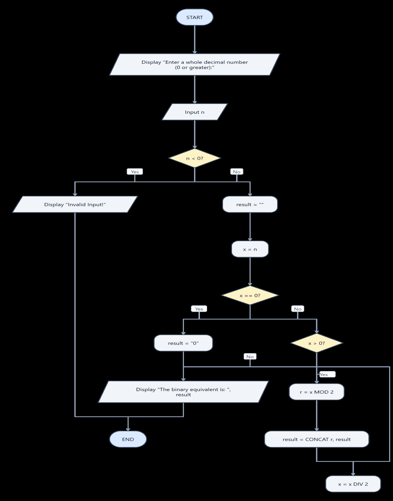
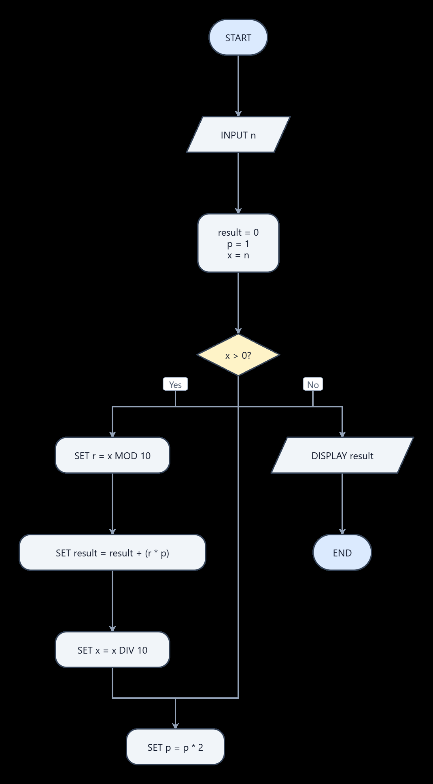

# ACTIVITY 6 - PROBLEM TO README

## Page 1

<p align="center">
Republic of the Philippines<br>
<strong>Sorsogon State University</strong><br>
<strong>COLLEGE OF INFORMATION</strong><br>
<strong>AND COMMUNICATIONS TECHNOLOGY</strong><br>
<strong>Bulan Campus</strong><br>
<em>Zone 8, Bulan, Sorsogon</em><br>
Tel. No.; 056 311-0103; Email Address:cict@sorsu.edu.ph
</p>

<p align="center"><strong>CC 101 – Introduction to Computing<br>
“From Problem to README”: Designing a Number-System Converter and Documenting It in Markdown</strong></p>

<table>
  <tr>
    <td><strong>Name:</strong> Kylie A. Estonanto</td>
    <td><strong>Block:</strong> BSCS 1-1</td>
  </tr>
  <tr>
    <td><strong>Date:</strong> 10.17.26</td>
    <td><strong>Computer Unit Used (Desktop/Laptop, brand):</strong> HP</td>
  </tr>
</table>

**I.  Objectives**

At the end of this activity, you should be able to:

• Analyze a number-system conversion problem by identifying its inputs, processes, loop
condition, and outputs.

• Write pseudocode using sequence, selection, and iteration.

• Draw flowcharts using standard symbols and check them by tracing and testing with
sample data.

• Create a properly formatted README.md file in Markdown using Notepad, without an
Internet connection.

• Upload the README.md to your CC 101 GitHub Computing Portfolio repository (take-home
part).

**II.  Materials Needed**

• A computer running Windows 11 with Notepad (no network or Internet connection is
needed in the laboratory)

• This worksheet, a pencil, and a ruler (or a flowchart template) for drawing flowcharts

• A USB flash drive, to bring your README.md home for uploading

• For Part G only (outside the laboratory): any device with Internet access and a free GitHub
account

• Week 7 lecture notes, for reference on pseudocode, flowchart symbols, and Markdown
syntax

**III.  Background**

Programmers do not start by typing code. They first analyze the problem, plan the solution as
pseudocode and a flowchart, and check it by hand. In this activity, you will design a program
that converts numbers between the decimal and binary number systems you learned in Week 5.
An algorithm can be written as pseudocode (English-like steps) or drawn as a flowchart (standard
symbols connected by arrows). Good work is also documented. On GitHub, the standard way to
introduce a project is a README.md file written in Markdown, a plain-text format that uses symbols such as #,*, and - for headings, emphasis, and lists. Because Markdown is plain text, you can write it in Notepad with no Internet connection and upload it to GitHub later.

**IV.  Procedure**

***Part A – Analyze the Problem (Problem 1)***

**Problem 1: Decimal-to-Binary Converter.**Design a program that asks the user for a whole number in **decimal** (base 10) that is 0 or greater, converts it to**binary**(base 2), and displays the binary
result.

---

## Page 2

**Worked example (13 in decimal):** 13 ÷ 2 = 6 r 1;  6 ÷ 2 = 3 r 0;  3 ÷ 2 = 1 r 1;  1 ÷ 2 = 0 r 1. Reading the remainders from bottom to top gives **1101**.

1. Convert 13 and 25 to binary by hand using the method above, so you understand every
step before writing the pseudocode.

2. Complete **Table 1** : list the input, the output, the processes (operations), the decision or loop condition, and the variables you will need.

***Part B – Write the Pseudocode***

3. In **Box 1**, write the pseudocode for Problem 1. Use START, INPUT, SET, WHILE … DO …
ENDWHILE, IF … THEN … ELSE … ENDIF, DISPLAY, and END, and indent the steps inside the
loop.

Tip: Use **MOD** for the remainder of a division (13 MOD 2 = 1) and **DIV** for whole-number division (13 DIV 2 = 6). Each new remainder must be placed at the **left** of the binary digits found so far, for example SET binary = remainder + binary. Also decide what your algorithm should display when the input is 0.

***Part C – Draw the Flowchart and Desk Check***

4. In **Figure 1**, draw the flowchart for Problem 1 using the standard symbols: oval (start/end), parallelogram (input/output), rectangle (process), and diamond (decision). Show the loop
with an arrow going back to the decision, and label every decision exit **Yes** or **No**.

5. Trace your pseudocode with the input **13** and fill in one row of **Table 2** for each pass
through the loop. The last column should end with 1101.

6. Test your pseudocode and flowchart with the five inputs in **Table 3**. First convert each
number by hand, then follow your pseudocode or flowchart step by step. If the two results
do not match, find and correct the error in your pseudocode and flowchart.

***Part D – Reverse Conversion (Problem 2)***

**Problem 2: Binary-to-Decimal Converter.** Design a program that asks the user for a binary number (entered as digits 0 and 1, such as 1101) and displays its decimal value. Use the **positional (place value) method** from Week 5: starting from the rightmost digit, multiply each digit by its place value (1, 2, 4, 8, 16, …) and add the products.

**Worked example (1101 in binary):** (1 × 1) + (0 × 2) + (1 × 4) + (1 × 8) = 1 + 0 + 4 + 8 = **13**.

7. In **Box 2**, write the pseudocode. You can take the rightmost digit with **binary MOD 10** and remove it with **binary DIV 10**; the place value starts at 1 and doubles after each digit.

8. In **Figure 2**, draw its flowchart.

9. Test your pseudocode with the inputs in **Table 4**, comparing hand computation with the
result of following your pseudocode.

10. **Optional / Bonus:** Extend Problem 1 so the user can choose the target base (2, 8, or 16).
For base 16, remainders 10 to 15 must be displayed as the letters A to F. Write the extended
pseudocode in the Bonus box.

***Part E – Create Your README.md Offline***

11. Show file extensions so that you can see the real file name. Press **Windows + E** to open File Explorer, then click **View**→**Show**→**File name extensions** (make sure it is checked).

12. In File Explorer, click **Documents**, then click **New**→**Folder**. Name the folder **cc101-portfolio** (all lowercase, with a hyphen) and press **Enter**. Open it and create two more folders inside: **week07-algorithms** and **images**.

13. Press the **Windows key**, type **Notepad**, and press **Enter**. If your Notepad shows a
formatting toolbar, open the **View** menu and switch to the Markdown **syntax** view so the
symbols you type stay visible.

14. Type the README content below. Replace everything in square brackets with your own
information, and replace the pseudocode with your pseudocode from Box 1. Keep the
blank lines; they separate the parts.

---

## Page 3

# CC 101 Computing Portfolio

This repository contains my laboratory outputs and documentation for *CC 101 Introduction to Computing* at **Sorsogon State University – Bulan Campus**. 

## About Me

-**Name:**[Your full name]
-**Program and Section:**BSCS 1-[section]
-**Interests:**[two or three interests]
-**Goal:**[one sentence about your goal as a computer science student]

## Course Information

| Item | Details |
| --- | --- |
| Course | CC 101 Introduction to Computing |
| Instructor | [Instructor's name] |
| Academic Year | 2026–2027 |

## Portfolio Contents

1. [Week 7 – Pseudocode and Flowcharts](week07-algorithms/)
2. More activities will be added each week.

## Sample Pseudocode: Decimal to Binary

```
[Paste your pseudocode from Box 1 here]
```

## My Workspace

!"[My laboratory computer]""(images/my-pc.jpg)"

---

*Last updated: [date in YYYY-MM-DD format]*

15. Save the file. Click **File**→**Save as**. Go to **Documents**→**cc101-portfolio**. Type **README.md** as the **File name**, set **Save as type** to **All files**, make sure **Encoding** is **UTF-8**, and click **Save**.

16. Verify the file. In File Explorer, open the cc101-portfolio folder and confirm the file is
named **README.md**, not README.md.txt. If it ends in .txt, right-click it, choose **Rename**, and remove .txt. Then press the **Windows key**, type **cmd**, press **Enter**, and run the commands below. Record the results in **Table 5**.

**cd %USERPROFILE%\Documents\cc101-portfolio**

**dir**

**type README.md**

Tip: If “The system cannot find the path specified” appears, your Documents folder may be
inside OneDrive. Try **cd %USERPROFILE%\OneDrive\Documents\cc101-portfolio** instead.

17. Optional preview: if your Notepad has a formatted view, switch to it from the **View** menu
and note in Table 5 which elements appear formatted. Some elements, such as tables,
images, and code blocks, may still appear as plain text. GitHub will display them correctly.

---

## Page 4

18. Copy the whole **cc101-portfolio** folder to your USB flash drive.

***Part F – Peer Review***

19. Exchange seats with a classmate. Open their README.md in Notepad and complete the
checklist in **Table 6** for their file. Write your name as the reviewer and return the worksheet. Fix any missing element in your own file before leaving.

***Part G – Take-Home: Upload to GitHub***

Do this part when you have Internet access (at home, on campus Wi-Fi, or on your phone's
browser in desktop mode).

20. Go to **github.com** and click **Sign up**. Use an email you check regularly and choose a

21. Click the **+** button at the upper right and choose **New repository**. Type **cc101-portfolio** as the **Repository name**, choose **Public**, and leave **Add a README file** unchecked. Click **Create repository**.

22. On the setup page, click the link **uploading an existing file**. Drag your README.md (and
your week07-algorithms folder, if it has files) onto the page.

23. Under **Commit changes**, type **Add initial README** as the message and click **Commit changes**.

24. Open your repository's main page and check that the README appears formatted.
Copy the repository URL (for example, https://github.com/username/cc101-portfolio),
record it in **Table 7**, and submit it through the LMS.

Note: GitHub does not store empty folders. The link to week07-algorithms will work after that
folder contains at least one file, and the image will appear after you upload images/my-
pc.jpg.

---

## Page 5

**V.  Data and Findings**

***Table 1. Problem Analysis for Problem 1 (Part A)***

<table>
  <tr>
    <th>Item</th>
    <th>Your Answer</th>
  </tr>
  <tr>
    <td>Restated problem (your<br>own words)</td>
    <td>Decimal to Binary Converter</td>
  </tr>
  <tr>
    <td>Input</td>
    <td>A non-negative whole number</td>
  </tr>
  <tr>
    <td>Output</td>
    <td>A Binary number</td>
  </tr>
  <tr>
    <td>Processes (operations)</td>
    <td>1. Ask for an integer input<br>2. Check if the value is &gt;= 0<br>3. Repeatedly divide the number by 2 and collect the<br>remainders<br>4. Reverse the remainders from bottom-to-top to<br>construct the final binary result<br>5. Print the binary output</td>
  </tr>
  <tr>
    <td>Loop condition (when the<br>loop stops)</td>
    <td>Decision: Check if input &lt; 0 to reject invalid numbers<br>Loop: A while loop running as long as the quotient &gt; 0</td>
  </tr>
  <tr>
    <td>Variables needed</td>
    <td>n - User’s input<br>x - Copies the User’s input and changes during the loop as it gets<br>divided down to 0<br>r - Stores the remainder every time you divide by 2<br>result - Collects and glues remainders together into a text string</td>
  </tr>
  <tr>
    <td>13 and 25 in binary<br>(computed by hand)</td>
    <td>13 - 1101<br>25 - 11001</td>
  </tr>
</table>

---

## Page 6

***Box 1. Pseudocode for Problem 1 (Part B)***

```text
START
    DISPLAY "Enter a whole decimal number (0 or greater): "
    INPUT n

    IF n < 0 THEN
        DISPLAY "Invalid Input!"
    ELSE
        SET result = ""
        SET x = n

        IF x == 0 THEN
            SET result = "0"
        ELSE
            WHILE x > 0 DO
                SET r = x MOD 2
                SET result = CONCAT(r, result)
                SET x = x DIV 2
            ENDWHILE
        ENDIF

        DISPLAY "The binary equivalent is: ", result
    ENDIF
END
```

---

## Page 7

***Figure 1. Flowchart for Problem 1 (Part C)***

*Draw your flowchart here.*



---

## Page 8

***Table 2. Trace of Problem 1 with Input 13 (Part C)***

<table>
  <tr>
    <th>Pass</th>
    <th>n (before)</th>
    <th>n MOD 2<br>(remainder)</th>
    <th>n DIV 2 (new n)</th>
    <th>binary (so far)</th>
  </tr>
  <tr>
    <td>1</td>
    <td>13</td>
    <td>1</td>
    <td>6</td>
    <td>1</td>
  </tr>
  <tr>
    <td>2</td>
    <td>6</td>
    <td>0</td>
    <td>3</td>
    <td>01</td>
  </tr>
  <tr>
    <td>3</td>
    <td>3</td>
    <td>1</td>
    <td>1</td>
    <td>101</td>
  </tr>
  <tr>
    <td>4</td>
    <td>1</td>
    <td>1</td>
    <td>0</td>
    <td>1101</td>
  </tr>
  <tr>
    <td>5</td>
    <td></td>
    <td></td>
    <td></td>
    <td></td>
  </tr>
</table>

Value displayed at the end: _1101___________________

***Table 3. Test Cases for Problem 1 (Part C)***


<table>
  <tr>
    <th>Case</th>
    <th>Decimal Input</th>
    <th>Binary (by hand)</th>
    <th>Binary From Your<br>Pseudocode</th>
    <th>Match?<br>(Y/N)</th>
  </tr>
  <tr>
    <td>1</td>
    <td>0</td>
    <td>0</td>
    <td>0</td>
    <td>Y</td>
  </tr>
  <tr>
    <td>2</td>
    <td>5</td>
    <td>101</td>
    <td>101</td>
    <td>Y</td>
  </tr>
  <tr>
    <td>3</td>
    <td>13</td>
    <td>1101</td>
    <td>1101</td>
    <td>Y</td>
  </tr>
  <tr>
    <td>4</td>
    <td>25</td>
    <td>11001</td>
    <td>11001</td>
    <td>Y</td>
  </tr>
  <tr>
    <td>5</td>
    <td>255</td>
    <td>11111111</td>
    <td>11111111</td>
    <td>Y</td>
  </tr>
</table>

---

## Page 9

***Box 2. Pseudocode for Problem 2 (Part D)***

```text
START
    DISPLAY "Enter a binary number: "
    INPUT n

    SET result = 0
    SET p = 1
    SET x = n

    WHILE x > 0 DO
        SET r = x MOD 10
        SET result = result + (r * p)
        SET x = x DIV 10
        SET p = p * 2
    ENDWHILE

    DISPLAY "The decimal equivalent is: ", result
END
```

---

## Page 10

***Figure 2. Flowchart for Problem 2 (Part D)***

*Draw your flowchart here.*



---

## Page 11

***Table 4. Test Cases for Problem 2 (Part D)***

<table>
  <tr>
    <th>Case</th>
    <th>Binary Input</th>
    <th>Decimal (by hand)</th>
    <th>Decimal From Your<br>Pseudocode</th>
    <th>Match?<br>(Y/N)</th>
  </tr>
  <tr>
    <td>1</td>
    <td>1101</td>
    <td>13</td>
    <td>13</td>
    <td>Y</td>
  </tr>
  <tr>
    <td>2</td>
    <td>101010</td>
    <td>42</td>
    <td>42</td>
    <td>Y</td>
  </tr>
  <tr>
    <td>3</td>
    <td>11111111</td>
    <td>255</td>
    <td>255</td>
    <td>Y</td>
  </tr>
  <tr>
    <td>4</td>
    <td>10000000</td>
    <td>128</td>
    <td>128</td>
    <td>Y</td>
  </tr>
</table>

***Bonus Box. Extended Pseudocode: Decimal to Base 2, 8, or 16 (Optional)***

```text
START
    DISPLAY "Enter a decimal number: "
    INPUT n

    DISPLAY "Enter base (2, 8, or 16): "
    INPUT b

    IF n < 0 THEN
        DISPLAY "Error: Number must be 0 or greater."
    ELSE IF b != 2 AND b != 8 AND b != 16 THEN
        DISPLAY "Error: Base must be 2, 8, or 16."
    ELSE
        SET result = ""
        SET x = n
        SET chars = "0123456789ABCDEF"

        IF x == 0 THEN
            SET result = "0"
        ELSE
            WHILE x > 0 DO
                SET r = x MOD b
                SET c = GET_CHAR(chars, r + 1)
                SET result = CONCAT(c, result)
                SET x = x DIV b
            ENDWHILE
        ENDIF

        DISPLAY "The conversion equivalent is: ", result
    ENDIF
END
```

---

## Page 12

***Table 5. README.md File Check (Part E)***

<table>
  <tr>
    <th>Item</th>
    <th>Your Findings</th>
  </tr>
  <tr>
    <td>Full folder path of cc101-portfolio</td>
    <td>C:\Users\HP\OneDrive\Documents\cc101-portfolio</td>
  </tr>
  <tr>
    <td>File name shown in File Explorer</td>
    <td>README.md</td>
  </tr>
  <tr>
    <td>Type shown in File Explorer (Details<br>view)</td>
    <td>Markdown Source File (.md)</td>
  </tr>
  <tr>
    <td>Size of README.md shown by dir<br>(bytes)</td>
    <td>2 KB</td>
  </tr>
  <tr>
    <td>Does type README.md show your<br>Markdown text? (Y/N)</td>
    <td>Y</td>
  </tr>
  <tr>
    <td>Notepad formatted view<br>available? (Y/N)</td>
    <td>Y</td>
  </tr>
  <tr>
    <td>Elements that appeared<br>formatted in Notepad (if<br>available)</td>
    <td>None</td>
  </tr>
</table>

---

## Page 13

***Table 6. Peer Review Checklist (Part F)***

Reviewer's name: <u>Kylie Estonanto</u>   
Owner of the README: <u>Aljade Bora</u>

<table>
  <tr>
    <th>Element</th>
    <th>Markdown Used</th>
    <th>Present and Correct?<br>(Y/N)</th>
  </tr>
  <tr>
    <td>Level-1 heading</td>
    <td>#</td>
    <td>Y</td>
  </tr>
  <tr>
    <td>Level-2 headings</td>
    <td>##</td>
    <td>Y</td>
  </tr>
  <tr>
    <td>Paragraph</td>
    <td>Text with a blank line before and after</td>
    <td>Y</td>
  </tr>
  <tr>
    <td>Bold and italic text</td>
    <td>**bold** *italic*</td>
    <td>Y</td>
  </tr>
  <tr>
    <td>Bulleted list</td>
    <td>- item</td>
    <td>Y</td>
  </tr>
  <tr>
    <td>Numbered list</td>
    <td>1. item</td>
    <td>Y</td>
  </tr>
  <tr>
    <td>Table</td>
    <td>| --- | header separator</td>
    <td>Y</td>
  </tr>
  <tr>
    <td>Link</td>
    <td>[text](url)</td>
    <td>Y</td>
  </tr>
  <tr>
    <td>Image</td>
    <td></td>
    <td>Y</td>
  </tr>
  <tr>
    <td>Code block</td>
    <td>Lines between two lines of three<br>backticks</td>
    <td>Y</td>
  </tr>
  <tr>
    <td>Horizontal rule</td>
    <td>---</td>
    <td>Y</td>
  </tr>
  <tr>
    <td>File saved as<br>README.md (not .txt)</td>
    <td>—</td>
    <td>Y</td>
  </tr>
</table>

***Table 7. GitHub Submission (Part G, Take-Home)***

<table>
  <tr>
    <th>Item</th>
    <th>Your Answer</th>
  </tr>
  <tr>
    <td>GitHub username</td>
    <td>kylieestonanto</td>
  </tr>
  <tr>
    <td>Repository URL</td>
    <td>https://github.com/kylieestonanto/cc101-portfolio</td>
  </tr>
  <tr>
    <td>Date uploaded (YYYY-MM-DD)</td>
    <td>2026-10-17</td>
  </tr>
  <tr>
    <td>Does the README display<br>formatted on GitHub? (Y/N)</td>
    <td>Y</td>
  </tr>
  <tr>
    <td>Elements that did not display as<br>expected, and why</td>
    <td>None</td>
  </tr>
</table>

---

## Page 14

**VI.  Realization (Reflection)**

*In two to four sentences each, answer the following in your own words.*

**1. Which was easier for you to create, the pseudocode or the flowchart? Why?**

The pseudocode because it is similar to actual code but in human readable
language. It allows you to focus on solving the problem in chunks without worrying
about the visual flow first. Pseudocode is like the foundational blueprint while a
flowchart serves as the visual blueprint.

**2. Did tracing and testing reveal any errors in your pseudocode or flowcharts? Describe what**
**you found and how you corrected it.**

Yes, testing it at first revealed a logical error, though my main concept was solid. I
corrected it by breaking the logic into smaller chunks and arranging them like puzzle
pieces. After researching to check my logic and refining the mistakes, I finalized the
pseudocode and used it to complete the flowchart.

**3. How is writing a README in Markdown different from typing a document in Microsoft Word?**

They have different formatting styles. In Microsoft Word, you can adjust the format
with a click of a button by using the graphical interface, while Markdown requires
you to use plain text and specific symbols to format the document.

**4. How can a GitHub portfolio help you as a future computing professional?**

A GitHub portfolio showcases your projects and technical progress that will help
potential employers know more about your experience. By demonstrating your skills
publicly, it effectively opens up diverse career opportunities both locally and globally.

---

## Page 15

**VII.  Scoring Guide**

<table>
  <tr>
    <th>Criteria</th>
    <th>Description</th>
    <th>Points</th>
  </tr>
  <tr>
    <td>Problem Analysis &amp;<br>Pseudocode</td>
    <td>Table 1 is complete; the pseudocode for both<br>conversions is correct (correct use of MOD, DIV,<br>and the loop), uses proper keywords, and is<br>indented.</td>
    <td>25</td>
  </tr>
  <tr>
    <td>Flowcharts &amp; Testing</td>
    <td>Both flowcharts use the correct symbols with<br>labeled decisions and a clear loop; the trace<br>(Table 2) and test cases (Tables 3 and 4) are<br>correct.</td>
    <td>25</td>
  </tr>
  <tr>
    <td>README.md</td>
    <td>The file is saved correctly as README.md, uses<br>all required Markdown elements, and passes<br>the peer review in Table 6.</td>
    <td>25</td>
  </tr>
  <tr>
    <td>GitHub Upload</td>
    <td>The README is uploaded to a public cc101-<br>portfolio repository and the URL is submitted<br>(Table 7).</td>
    <td>10</td>
  </tr>
  <tr>
    <td>Realization / Reflection</td>
    <td>Answers are thoughtful, specific to the student&#x27;s<br>own work, and well written.</td>
    <td>10</td>
  </tr>
  <tr>
    <td>Neatness &amp; Timeliness</td>
    <td>Worksheet is legible/well-formatted and<br>submitted on time.</td>
    <td>5</td>
  </tr>
  <tr>
    <td>Total</td>
    <td></td>
    <td>100</td>
  </tr>
</table>
---
